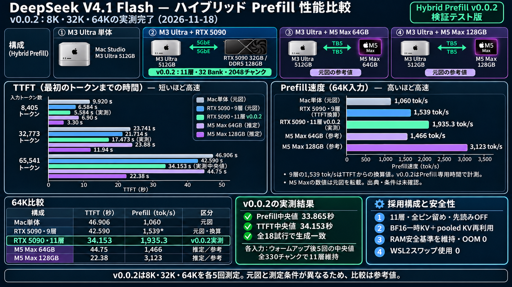

# Hybrid Prefill v0.0.2 (Experimental Release)

[日本語](README.md) · [Distribution ZIP](https://github.com/tamayanao/hybrid-prefill/raw/main/dist/Hybrid-Prefill-v0.0.2.zip)



Hybrid Prefill splits DeepSeek V4.1 Flash prefill between a Mac Studio and a Windows PC with an RTX 5090. The Mac keeps the full model and KV cache and handles decoding. The RTX processes the first layers, keeping three resident and streaming the additional expert weights from pinned WSL2 RAM.

At startup, the launcher uses installed Windows RAM, total and available WSL2 RAM, and the dedicated helper's 68 GiB limit. It reserves 12 GiB and selects 3–11 layers using weight sizes from checkpoint headers. The validated performance configuration uses 11 layers, 32 Expert Banks, 2,048-token chunks, fully pinned expert weights, and prefetch off.

## Measurements on real hardware

The diagram uses separate runs of the same 65,541-token prompt. The Mac-only point is one pilot run with an 8,192-token chunk. The 9-layer and 11-layer points are medians of five runs each with 2,048-token chunks. [TTFT measurements for all three configurations](benchmark/v0.0.2/64k-ttft-comparison.json)

| 65,541 tokens, same 11-layer configuration | Median prefill | Median TTFT | Prefill throughput |
| --- | ---: | ---: | ---: |
| BF16 scratch | 34.640 s | 34.927 s | 1,892.1 tok/s |
| BF16 scratch with pooled KV reuse | **33.811 s** | **34.098 s** | **1,938.4 tok/s** |

Measured on a Mac Studio (M3 Ultra, 512 GB) and an RTX 5090 PC (32 GB VRAM, 128 GB DDR5) over 5GbE with a 96 GB WSL2 limit. Each mode had one warm-up and five measured runs. All 12 outputs matched, and all 396 chunks retained the 11-layer cut. The experiment recorded minimums of 14.90 GiB of Windows commit headroom, 39.75 GiB of available Windows RAM, and 30.20 GiB of available WSL2 RAM during measurements. [Measurement data](benchmark/v0.0.2/64k-paired.json)

The release uses the validated 11-layer path. Twelve layers still produce a numeric divergence, and the Expert GEMM candidates have only been measured in isolated real-input replay. These results apply to the hardware and model listed above.

The 2026-11-18 remeasurement completed one warm-up and five measured runs at each of 8K, 32K and 64K using the released v0.0.2 launcher and helper. All 18 outputs matched the reference, and all 330 chunks retained 11 layers. [Remeasurements and memory results](docs/v0.0.2-measured-20261118.en.md)

## Setup

1. Prepare Python 3.11, uv, the Xcode command-line tools, and the `DeepSeek-V4.1-Flash-1017-oQ4e-mtp` checkpoint on the Apple Silicon Mac. Apply the included patch to the pinned oMLX commit.

   ```sh
   git clone https://github.com/jundot/omlx.git omlx
   git -C omlx checkout --detach bf28cd6c43541ececeec01ba797377c913da5f8f
   git -C omlx apply ../omlx.patch
   uv venv --python 3.11 omlx/.venv
   uv pip install --python omlx/.venv/bin/python -e ./omlx
   ```

   Use the Mac app in the distribution ZIP or run `bash build-mac.sh` to build it from source.

2. Set up Windows OpenSSH Server, WSL2 (Ubuntu 24.04), and a CUDA-enabled Docker Engine. Verify the Windows SSH host key from the Mac and enable key authentication and TCP forwarding. Free TCP ports 18880 and 8850–8852 on the Mac and at least 29 GiB of VRAM on the RTX 5090.
3. With WSL2 in NAT mode, use `ip route show default` to find the Windows-side gateway IPv4 address. From an elevated PowerShell session, forward TCP 18880 on that gateway address to `127.0.0.1:18880` on Windows. Scope the Windows Firewall rule to the WSL IPv4 address. Run the included `windows-helper/install.sh` inside WSL with the gateway IPv4 address as its argument. The first image build needs internet access.

   ```powershell
   # Substitute the Windows-side gateway and WSL guest addresses
   $gateway = 'WINDOWS_WSL_GATEWAY_IPV4'
   $wslIp = 'WSL_IPV4'
   netsh interface portproxy add v4tov4 listenaddress=$gateway listenport=18880 connectaddress=127.0.0.1 connectport=18880
   New-NetFirewallRule -DisplayName 'Hybrid Prefill WSL pairing' -Direction Inbound -Action Allow -Protocol TCP -LocalAddress $gateway -LocalPort 18880 -RemoteAddress $wslIp
   ```

   In WSL, run `bash windows-helper/install.sh WINDOWS_WSL_GATEWAY_IPV4`. Review the forwarding and firewall addresses if the WSL network is reassigned.
4. Open the app and choose **設定ファイルを開く** (Open Settings File). Fill in `pc_host` and `pc_user`, and optionally `ssh_key` and `ssh_host_key_alias`. Set `wsl_distribution` to the name of the distribution that hosts the helper. Set `omlx_python` to the venv interpreter from step 1, `model_directory` to the parent directory of the checkpoint, and `model_id` to the checkpoint directory name.
5. For a fresh installation, run the command below in Mac Terminal. Enter the six-digit code shown by `docker logs hybrid-prefill-helper` in WSL. The launcher saves `helper_node_id`.

   ```sh
   /usr/bin/python3 launcher/launch.py "$HOME/Library/Application Support/HybridPrefill/launcher.json" --pair
   ```

6. Check free disk space on the PC and enable `copy_missing_model_files` if the helper needs to receive the model shards. Click **起動** (Start) and check the selected layer count and running status. Click **停止** (Stop) to shut down. The API is at `http://127.0.0.1:18880/v1` on the Mac, and the API key is stored in `state/settings.json` inside the settings directory.

Set `max_layers` to cap the assignment within the 3–11 layer range. Model weights, SSH keys, API keys, and pairing state are supplied by each installation. The Mac app is an ad hoc-signed verification build.

Set `reuse_pooled_kv` to `false` to return to the BF16 scratch path. The installer sets a 68 GiB limit for the dedicated helper container. Manage global WSL2 and Docker settings separately. The launcher monitors Windows commit headroom, Windows available RAM, and WSL2 available RAM.

To upgrade from v0.0.1, stop the old helper and rename its container before running the included installer. The existing `hybrid-prefill-helper` data volume and Mac settings can be reused. Keep the old helper stopped while the new one runs.
