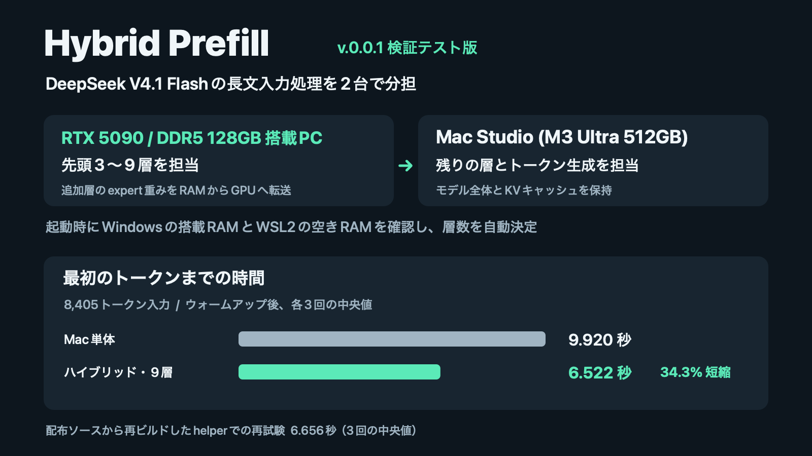

# Hybrid Prefill v.0.0.1 検証テスト版

[English](README.en.md)



Mac Studio（M3 Ultra）とRTX 5090搭載Windows PCで、DeepSeek V4.1 Flashの入力処理（Prefill）を分担します。Macがモデル全体とKVキャッシュを保持し、RTX 5090が先頭の層を処理します。最初の3層はGPUに常駐し、追加の層のexpert重みはピン留めしたPC側のRAMからGPUへ転送します。

起動時にWindowsの搭載RAM、WSL2の総RAMと利用可能RAMを取得します。最小値から12 GiBを残し、チェックポイントのヘッダーから算出した重みサイズで3〜9層を選びます。既定のチャンク上限は2,048トークンです。8,192トークンに引き上げた試験ではVRAM不足により担当層が減りました。

## 実機計測

| 入力トークン | 構成 | 最初のトークンまで（TTFT） |
| --- | --- | ---: |
| 8,405 | Mac単体、ウォームアップ後3回の中央値 | 9.920秒 |
| 8,405 | 検証版ランチャー・9層、ウォームアップ後3回の中央値 | 6.522秒 |
| 32,773 | 9層、予備測定1回 | 21.714秒 |
| 65,541 | 9層、予備測定1回 | 42.590秒 |

8,405トークンではTTFTが34.3%短縮しました。長文2条件は単発測定です。32,773トークンの出力は8層での試行と一致しませんでした。計測条件とデータは [benchmark](benchmark) にあります。

## 検証範囲

実機で9層の自動選択、初回ペアリング、推論、通常停止を確認しました。検証機は搭載RAM 125.6 GiB、起動時のWSL2利用可能RAMは約60.5 GiB、ピン留め重みは40.3 GiBでした。別の機材構成や、空ボリュームへのモデル転送は未検証です。

## セットアップ

1. MacにApple Silicon向けのPython 3.11、uv、Xcodeのコマンドラインツールと、モデル `DeepSeek-V4.1-Flash-1017-oQ4e-mtp` を用意します。下記の固定コミットに同梱パッチを適用して開発版oMLXを作ります。

   ```sh
   git clone https://github.com/jundot/omlx.git omlx
   git -C omlx checkout --detach bf28cd6c43541ececeec01ba797377c913da5f8f
   git -C omlx apply ../omlx.patch
   uv venv --python 3.11 omlx/.venv
   uv pip install --python omlx/.venv/bin/python -e ./omlx
   ```

   配布ZIPのMacアプリを使用できます。ソースから再ビルドする場合は `bash build-mac.sh` を実行します。

2. WindowsにOpenSSH Server、WSL2（Ubuntu 24.04）、CUDA対応のDocker Engineを用意します。MacからWindowsへのSSHホスト鍵を確認し、鍵認証とTCP転送を使える状態にします。MacではTCP 18880と8850〜8852を空け、RTX 5090に29 GiB以上の空きVRAMを確保します。
3. WSL2のNAT環境では、`ip route show default` でWindows側ゲートウェイのIPv4を確認します。Windowsの管理者PowerShellで、そのゲートウェイのTCP 18880だけをWindows側 `127.0.0.1:18880` へ転送します。Windowsファイアウォールではアクセス元をWSLのIPv4に限定します。WSLで同梱の `windows-helper/install.sh` を実行し、ゲートウェイIPv4を引数に指定します。初回イメージビルドにネット接続が必要です。

   ```powershell
   # 実環境のWSLゲートウェイとWSL IPv4に置き換える
   $gateway = 'WINDOWS_WSL_GATEWAY_IPV4'
   $wslIp = 'WSL_IPV4'
   netsh interface portproxy add v4tov4 listenaddress=$gateway listenport=18880 connectaddress=127.0.0.1 connectport=18880
   New-NetFirewallRule -DisplayName 'Hybrid Prefill WSL pairing' -Direction Inbound -Action Allow -Protocol TCP -LocalAddress $gateway -LocalPort 18880 -RemoteAddress $wslIp
   ```

   WSL内で `bash windows-helper/install.sh WINDOWS_WSL_GATEWAY_IPV4` を実行します。WSLのアドレスが変わった場合は転送先と接続元の指定を見直してください。
4. Macアプリを開き、「設定ファイルを開く」を選びます。Windowsの `pc_host` と `pc_user`、必要に応じて `ssh_key`、`ssh_host_key_alias` を設定します。`wsl_distribution` は配置先の名前です。`omlx_python` は手順1の `omlx/.venv/bin/python`、`model_directory` はチェックポイントの親ディレクトリ、`model_id` はチェックポイント名です。
5. MacのTerminalで以下を実行します。WSLの `docker logs hybrid-prefill-helper` に表示される6桁のコードを入力すると、`helper_node_id` が保存されます。

   ```sh
   /usr/bin/python3 launcher/launch.py "$HOME/Library/Application Support/HybridPrefill/launcher.json" --pair
   ```

6. 初回はモデルの必要なシャードを転送するため、Windows側の空きディスク容量を確認し、`copy_missing_model_files` を `true` にします。Macアプリで「起動」を押し、選ばれた層数と稼働中表示を確認します。終了は「停止」です。APIはMacの `http://127.0.0.1:18880/v1`、APIキーは設定ディレクトリ内の `state/settings.json` に保存されます。

`max_layers` で上限を3〜9層の範囲で変更できます。モデル重み、SSH鍵、APIキー、ペアリング情報は利用環境ごとに用意します。Macアプリはローカル署名の検証ビルドです。
